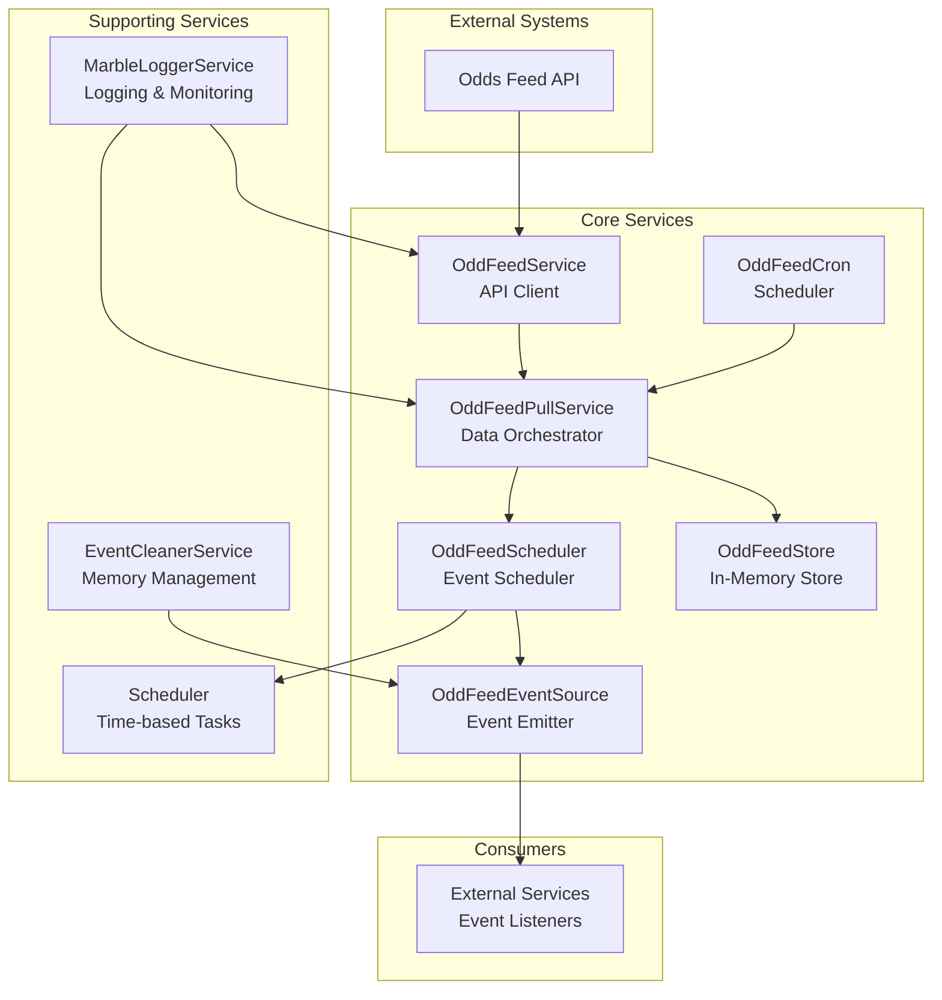
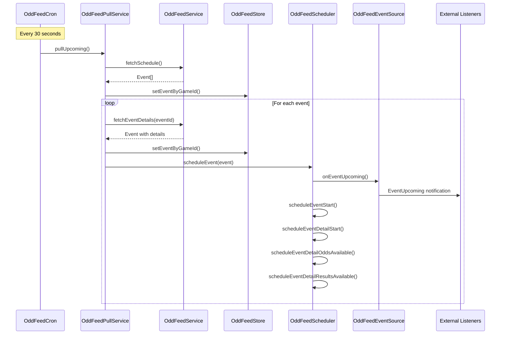
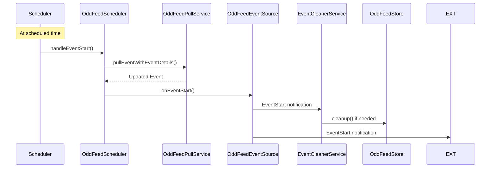

# Odd Feed Client

Event-based odd feed client for Marble games. Provides a small set of services to pull schedules and event details, emit domain events, and manage an in-memory store. Ships with a simple dependency injection setup and an Awilix adapter.

## Project Overview

The **odd-feed-client** is a TypeScript library that acts as a bridge between external odds feed APIs and Marble game services. It periodically fetches event data, schedules event processing, and emits domain events for consumption by other services.

### Main Purpose

- **Data Ingestion**: Pulls event schedules and details from external odds feed APIs
- **Event Scheduling**: Schedules time-based events (event starts, odds availability, results)
- **Event Publishing**: Emits domain events for downstream services to consume
- **Data Management**: Maintains in-memory store of events keyed by gameId and eventId
- **Lifecycle Management**: Handles event cleanup and memory management

## Architecture Map



## Features & Services

### Core Services

| Service                | Purpose                  | Key Methods                                                      | Dependencies                                        |
| ---------------------- | ------------------------ | ---------------------------------------------------------------- | --------------------------------------------------- |
| **OddFeedService**     | API client for odds feed | `fetchSchedule()`, `fetchEventDetails()`, `getRemoteJson()`      | AppConfigs, Logger, MarbleLoggerService             |
| **OddFeedPullService** | Data orchestration       | `pullUpcoming()`, `pullEventWithEventDetails()`                  | OddFeedService, OddFeedStore, Logger, oddFeedFilter |
| **OddFeedCron**        | Periodic scheduling      | `start()`, `scheduleNextEventsCron()`                            | OddFeedPullService, OddFeedScheduler, Logger        |
| **OddFeedScheduler**   | Event timing             | `scheduleEvent()`, `scheduleEventUpcoming()`                     | OddFeedEventSource, Scheduler, OddFeedPullService   |
| **OddFeedStore**       | In-memory storage        | `setEventByGameId()`, `getEventByGameId()`, `cleanup()`          | OddFeedEventSource                                  |
| **OddFeedEventSource** | Event emission           | `onEventStart()`, `onEventUpcoming()`, `registerEventListener()` | None (EventEmitter)                                 |

### Supporting Services

| Service                 | Purpose                   | Key Methods                                | Dependencies       |
| ----------------------- | ------------------------- | ------------------------------------------ | ------------------ |
| **EventCleanerService** | Memory management         | `handleEventStart()`, `dispose()`          | OddFeedEventSource |
| **MarbleLoggerService** | Logging & monitoring      | `log()`, `error()`, `warning()`, `debug()` | AppConfigs         |
| **Scheduler**           | Time-based task execution | `schedule()`, `cancel()`, `dispose()`      | None               |

## Cron Flow

### Main Execution Flow



### Event Lifecycle



## Technical Stack

### Dependencies

- **Runtime**: Node.js >= 18
- **Language**: TypeScript 5.9.3
- **DI Container**: Awilix 12.0.5
- **Cron**: cron 4.3.3
- **Monitoring**: @sentry/node 10.17.0
- **Testing**: Jest 30.2.0

### Key Libraries

- **EventEmitter**: Node.js built-in for event handling
- **Fetch API**: For HTTP requests to odds feed APIs
- **BigInt**: For event ID manipulation (gameId/roundId extraction)

## Component Guide

### Domain Models

#### Event (`src/domain/index.ts`)

```typescript
type Event = {
  eventID: number;
  eventNameAKey: string;
  eventNameBKey: string;
  theme?: string;
  scheduleStartTs: string;
  productCode: string;
  productTypeKey: string;
  eventDetails: EventDetail[];
  voiceConfig?: string;
};
```

#### EventDetail (`src/domain/index.ts`)

```typescript
type EventDetail = {
  eventID: number;
  oddsAvailableTs: string;
  scheduleStartTs: string;
  resultsAvailableTs: string;
  hasResults: boolean;
  goalInfo: string;
  playlist: string;
  result: string;
  markets: any;
  inGameEventInfo: string;
  phase: number;
};
```

### Service Details

#### OddFeedService (`src/services/odd-feed-service.ts`)

- **Authentication**: Handles OAuth token management
- **API Calls**: Makes HTTP requests to odds feed endpoints
- **Retry Logic**: Built-in retry mechanism with exponential backoff
- **Error Handling**: Comprehensive error logging via MarbleLoggerService

#### OddFeedPullService (`src/services/odd-feed-pull-service.ts`)

- **Data Orchestration**: Coordinates between API calls and storage
- **Filtering**: Applies user-defined filters to events
- **Storage**: Manages event storage in OddFeedStore
- **Game ID Extraction**: Uses idHelper to extract gameId from eventId

#### OddFeedScheduler (`src/services/odd-feed-scheduler.ts`)

- **Event Scheduling**: Schedules multiple event types per event
- **Time Management**: Handles different timestamps (start, odds, results)
- **Event Emission**: Triggers appropriate events at scheduled times
- **Retry Logic**: Built-in retry for result availability

#### OddFeedStore (`src/services/odd-feed-store.ts`)

- **In-Memory Storage**: `Record<string, Record<number, Event>>` structure
- **Game-based Organization**: Events organized by gameId, then eventId
- **Cleanup Management**: Handles event cleanup via EventCleanerService
- **Lifecycle**: Registers for system cleanup events

#### EventCleanerService (`src/services/event-cleaner-service.ts`)

- **Memory Management**: Prevents memory leaks by cleaning old events
- **Queue Management**: Maintains FIFO queue per game (max 50 events)
- **Automatic Cleanup**: Triggers cleanup when queue exceeds limit
- **Event Emission**: Emits system cleanup events

### Dependency Injection

#### Registration (`src/dependency-injection/index.ts`)

```typescript
// Core services registered as singletons
marbleLoggerService -> MarbleLoggerServiceImpl
oddFeedEventSource -> OddFeedEventSourceImpl
oddFeedPullService -> OddFeedPullServiceImpl
oddFeedScheduler -> OddFeedSchedulerImpl
oddFeedStore -> OddFeedStoreImpl (with disposer)
eventCleanerService -> EventCleanerServiceImpl (with disposer)
scheduler -> SchedulerImpl (with disposer)
oddFeedService -> OddFeedServiceImpl
oddFeedCron -> OddFeedCronImpl
oddFeedFilter -> Function (configurable)
```

#### Initialization Flow

1. **MarbleLoggerService.init()** - Initialize logging
2. **OddFeedStore.initEvent()** - Register cleanup listeners
3. **EventCleanerService.initEvent()** - Register event listeners
4. **OddFeedCron.start()** - Start periodic scheduling

## Improvements & Refactors

### High Priority Issues

#### 1. **Console.log Usage** (Lines: `src/services/odd-feed-scheduler.ts:118`, `src/services/odd-feed-store.ts:56`)

- **Issue**: Direct console.log usage instead of proper logging
- **Impact**: Inconsistent logging, no log level control
- **Fix**: Replace with MarbleLoggerService calls
- **Files**: `src/services/odd-feed-scheduler.ts`, `src/services/odd-feed-store.ts`

#### 2. **Type Safety Issues** (Lines: `src/container/awilix/index.ts:79`, `src/services/scheduler.ts:57`)

- **Issue**: `any` types in critical paths
- **Impact**: Loss of type safety, potential runtime errors
- **Fix**: Add proper type definitions for container cradle and callback args
- **Files**: `src/container/awilix/index.ts`, `src/services/scheduler.ts`

#### 3. **Error Handling Inconsistency**

- **Issue**: Mixed error handling patterns (console.error vs MarbleLoggerService)
- **Impact**: Inconsistent error reporting
- **Fix**: Standardize on MarbleLoggerService for all error logging

### Medium Priority Improvements

#### 4. **Memory Management**

- **Issue**: In-memory store grows indefinitely without proper cleanup
- **Impact**: Potential memory leaks in long-running processes
- **Fix**: Implement TTL-based cleanup and memory monitoring
- **Files**: `src/services/odd-feed-store.ts`, `src/services/event-cleaner-service.ts`

#### 5. **Configuration Management**

- **Issue**: Hardcoded values (MAX*LENGTH = 50, cron expression "*/30 \_ \* \* \* \*")
- **Impact**: Inflexible configuration
- **Fix**: Make configurable via AppConfigs interface
- **Files**: `src/services/event-cleaner-service.ts`, `src/services/odd-feed-cron.ts`

#### 6. **Async/Await Patterns**

- **Issue**: Mixed Promise handling patterns
- **Impact**: Potential race conditions and error handling issues
- **Fix**: Standardize on async/await with proper error boundaries
- **Files**: `src/services/odd-feed-cron.ts:45-51`

### Low Priority Enhancements

#### 7. **Testing Coverage**

- **Issue**: Limited test coverage for complex scenarios
- **Impact**: Potential bugs in edge cases
- **Fix**: Add integration tests for event flows and error scenarios

#### 8. **Documentation**

- **Issue**: Missing JSDoc comments for public APIs
- **Impact**: Poor developer experience
- **Fix**: Add comprehensive JSDoc documentation

#### 9. **Performance Optimization**

- **Issue**: Synchronous event processing in forEach loops
- **Impact**: Blocking operations during event processing
- **Fix**: Implement batch processing and async event handling

### Architectural Improvements

#### 10. **Event Store Persistence**

- **Issue**: In-memory store lost on restart
- **Impact**: Data loss during service restarts
- **Fix**: Add optional persistence layer (Redis, database)

#### 11. **Health Checks**

- **Issue**: No health monitoring for external API connectivity
- **Impact**: Silent failures in API communication
- **Fix**: Implement health check endpoints and monitoring

#### 12. **Rate Limiting**

- **Issue**: No rate limiting for API calls
- **Impact**: Potential API throttling or blocking
- **Fix**: Implement rate limiting and backoff strategies

### Code Quality Issues

#### 13. **Magic Numbers**

- **Issue**: Hardcoded values throughout codebase
- **Impact**: Difficult maintenance and configuration
- **Fix**: Extract to constants or configuration

#### 14. **Error Recovery**

- **Issue**: Limited error recovery mechanisms
- **Impact**: Service failures cascade through system
- **Fix**: Implement circuit breaker patterns and graceful degradation

#### 15. **Monitoring & Observability**

- **Issue**: Limited metrics and monitoring
- **Impact**: Difficult to diagnose production issues
- **Fix**: Add comprehensive metrics collection and alerting

### Naming & API Design Issues

#### 16. **Confusing Method Naming** (`src/services/odd-feed-event-source.ts`, `src/interfaces/odd-feed-event-source.ts`)

- **Issue**: Methods named `onEventStart()`, `onEventUpcoming()` actually **emit** events, not listen to them
- **Impact**: Misleading API - developers expect these to be listeners, not emitters
- **Fix**: Rename to `emitEventStart()`, `emitEventUpcoming()` for clarity
- **Files**: `src/services/odd-feed-event-source.ts:51-84`, `src/interfaces/odd-feed-event-source.ts:49-55`

#### 17. **Inconsistent EventEmitter API** (`src/services/odd-feed-event-source.ts`)

- **Issue**: Uses `register/unregister` instead of standard EventEmitter `on/off` methods
- **Impact**: Inconsistent with Node.js EventEmitter conventions
- **Fix**: Rename to `on/off` methods for consistency with EventEmitter API
- **Files**: `src/services/odd-feed-event-source.ts:20-49`, `src/interfaces/odd-feed-event-source.ts:40-48`

#### 18. **Misleading "Notification" Naming** (`src/interfaces/odd-feed-event-source.ts`)

- **Issue**: Types named `EventNotification`, `EventDetailNotification` contain event data, not notifications
- **Impact**: Confusing naming - these are payloads/messages, not notifications
- **Fix**: Rename to `EventPayload`, `EventDetailPayload`, `SystemPayload`
- **Files**: `src/interfaces/odd-feed-event-source.ts:17-30`

#### 19. **Inconsistent Property Naming** (`src/services/odd-feed-event-source.ts`)

- **Issue**: Property `OddFeedEventSource` (PascalCase) should be `oddFeedEventSource` (camelCase)
- **Impact**: Inconsistent with TypeScript/JavaScript naming conventions
- **Fix**: Rename to camelCase following standard conventions
- **Files**: `src/services/odd-feed-event-source.ts:15,18`

#### 20. **Redundant Event Detail Registration** (`src/services/odd-feed-event-source.ts`)

- **Issue**: Separate `registerEventDetailEventListener` method that does the same as `registerEventListener`
- **Impact**: Unnecessary API complexity and confusion
- **Fix**: Remove redundant method, use single `registerEventListener` for all event types
- **Files**: `src/services/odd-feed-event-source.ts:35-41`, `src/interfaces/odd-feed-event-source.ts:45-46`

#### 21. **Inconsistent Event Name Casing** (`src/interfaces/odd-feed-event-source.ts`)

- **Issue**: Mixed casing in event names (`EventDetailUpComing` vs `EventUpcoming`)
- **Impact**: Inconsistent API design
- **Fix**: Standardize to consistent casing (e.g., `EventDetailUpcoming`)
- **Files**: `src/interfaces/odd-feed-event-source.ts:6,10`

#### 22. **Generic Type Redundancy** (`src/interfaces/odd-feed-event-source.ts`)

- **Issue**: Repetitive `<TEvent extends Event = Event>` throughout interfaces
- **Impact**: Verbose and hard to maintain
- **Fix**: Create base types or use type aliases to reduce repetition
- **Files**: `src/interfaces/odd-feed-event-source.ts:17-38`

---

## Requirements

- Node.js >= 18

## Installation

```bash
npm install odds-feed-client
# or
yarn add odds-feed-client
# or
pnpm add odds-feed-client
```

If you use the Awilix adapter shown below, also install `awilix` (it is already a dependency here, so this is optional for most setups):

```bash
npm install awilix
```

## Quick start (TypeScript)

The `example/` folder contains a runnable sample. Below is the minimal setup using Awilix.

```ts
import { createContainer, asClass, asValue } from "awilix";
import { register, init } from "odd-feed-client/dependency-injection";
import { AwilixDIContainer } from "odd-feed-client/awilix";
import type {
  AppConfigs,
  Logger,
  OddFeedEventSource,
  OddFeedEventName,
} from "odd-feed-client";

// 1) App configuration
const appConfigs: AppConfigs = {
  oddsFeedAPI: {
    url: "https://your-odds-feed-host",
    operatorId: "<operator-id>",
    password: "<operator-password>",
  },
};

// 2) Logger implementation (only logError is required)
class ConsoleLogger implements Logger {
  public logError(message: string) {
    console.error(message);
  }
}

// 3) Create Awilix container and register your own bindings
const container = createContainer();
container.register({
  appConfigs: asValue(appConfigs),
  logger: asClass(ConsoleLogger),
});

// 4) Wrap as a DI container and register odds-feed services
const di = new AwilixDIContainer(container);
register(di);
init(di); // starts cron and internal listeners

// 5) (Optional) Listen to feed events
const eventSource = di.resolve<oddsFeedEventSource>("oddsFeedEventSource");
eventSource.registerEventListener(
  OddFeedEventName.EventUpcoming,
  ({ event }) => {
    console.log("Upcoming event:", event.eventID);
  }
);
```

This will:

- authenticate to the odds feed and pull the schedule
- periodically (every ~30s) reschedule and fetch event details
- emit domain events via the internal event source
- store events in an in-memory store keyed by gameId and eventId

### Reading from the store

```ts
import type { oddsFeedStore } from "odds-feed-client";

const store = di.resolve<oddsFeedStore>("oddsFeedStore");
const event = store.getEventByGameId("<game-id>", /* eventId */ 123456);
```

### Odd feed filter (container value)

`oddsFeedPullService` can take an optional filter to decide which events to keep. Register a value named `oddsFeedFilter` in your container. It can be either:

- a function `(event) => boolean` (predicate), or
- a boolean (`true` to include all, `false` to include none).

If you don't register it, all events are included by default.

```ts
// Keep all events (default behavior example)
container.register({
  oddFeedFilter: asValue(true), // include all events
});

// Example: only include events for specific IDs
container.register({
  oddFeedFilter: asValue((event) => [111, 222, 333].includes(event.eventID)),
});
```

### Without Awilix

You can bring your own DI by implementing `DiContainer` and passing it to `register` and `init`. See `odds-feed-client/container` for the minimal required interface.

### Example app

Check `example/` for a complete, runnable setup that mirrors the snippets above.

### Exports

- `odds-feed-client`: re-exports interfaces and domain types
- `odds-feed-client/dependency-injection`: `register(diContainer)`, `init(diContainer)`
- `odds-feed-client/awilix`: `AwilixDIContainer` adapter
