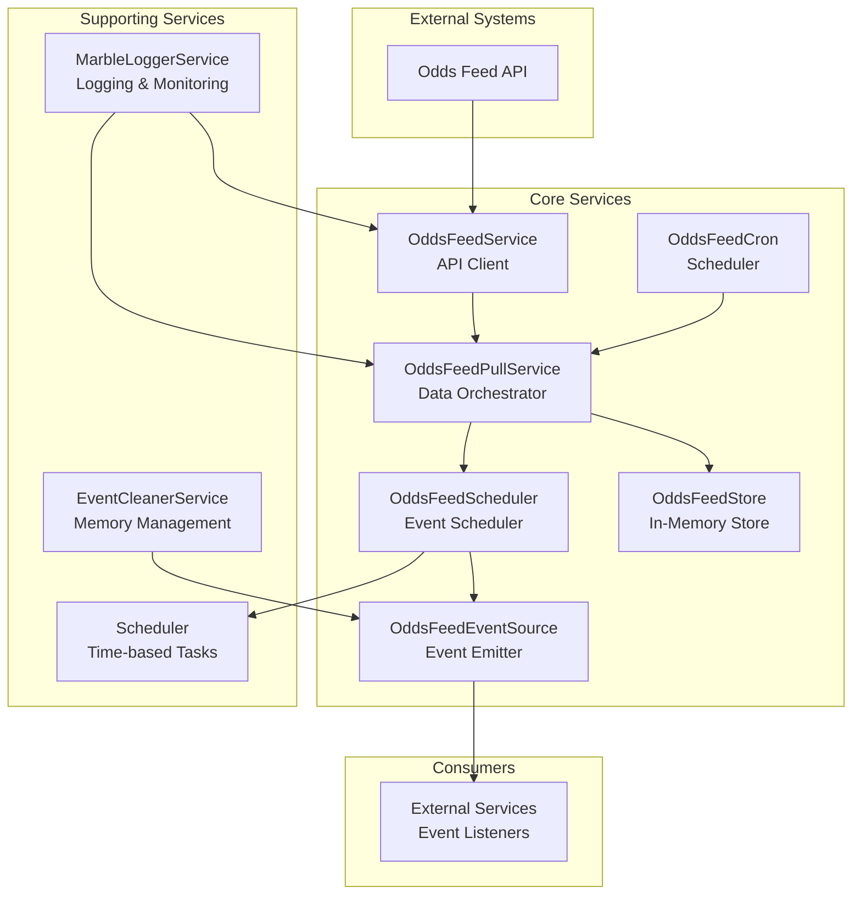
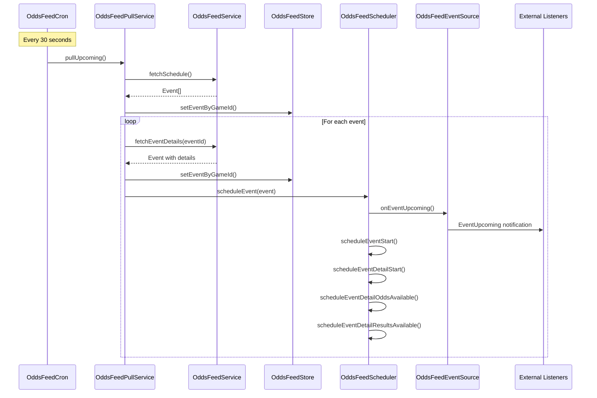
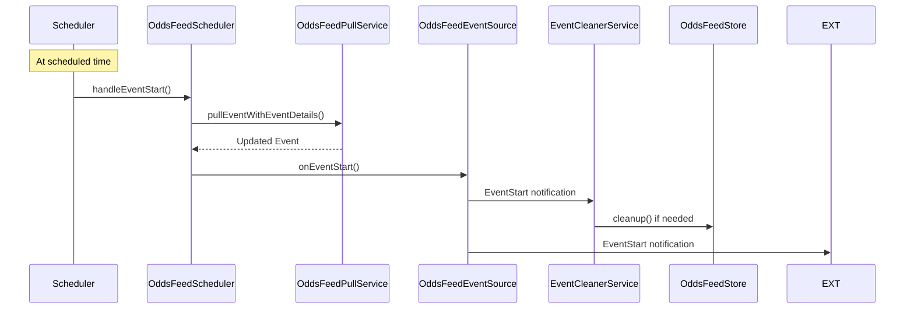

# Odds Feed Client

Event-based odds feed client for Marble games. Provides a small set of services to pull schedules and event details, emit domain events, and manage an in-memory store. Ships with a simple dependency injection setup and an Awilix adapter.

## Project Overview

The **odds-feed-client** is a TypeScript library that acts as a bridge between external odds feed APIs and Marble game services. It periodically fetches event data, schedules event processing, and emits domain events for consumption by other services.

### Main Purpose

- **Data Ingestion**: Pulls event schedules and details from external odds feed APIs
- **Event Scheduling**: Schedules time-based events (event starts, odds availability, results)
- **Event Publishing**: Emits domain events for downstream services to consume
- **Data Management**: Maintains in-memory store of events keyed by gameId and eventId
- **Lifecycle Management**: Handles event cleanup and memory management

## Architecture Map



## Features & Services

### Core Services

| Service                 | Purpose                  | Key Methods                                                 | Dependencies                                           |
| ----------------------- | ------------------------ | ----------------------------------------------------------- | ------------------------------------------------------ |
| **OddsFeedService**     | API client for odds feed | `fetchSchedule()`, `fetchEventDetails()`, `getRemoteJson()` | AppConfigs, Logger, MarbleLoggerService                |
| **OddsFeedPullService** | Data orchestration       | `pullUpcoming()`, `pullEventWithEventDetails()`             | OddsFeedService, OddsFeedStore, Logger, oddsFeedFilter |
| **OddsFeedCron**        | Periodic scheduling      | `start()`, `scheduleNextEventsCron()`                       | OddsFeedPullService, OddsFeedScheduler, Logger         |
| **OddsFeedScheduler**   | Event timing             | `scheduleEvent()`, `scheduleEventUpcoming()`                | OddsFeedEventSource, Scheduler, OddsFeedPullService    |
| **OddsFeedStore**       | In-memory storage        | `setEventByGameId()`, `getEventByGameId()`, `cleanup()`     | OddsFeedEventSource                                    |
| **OddsFeedEventSource** | Event emission           | `emitEventStart()`, `emitEventUpcoming()`, `eventOn()`      | None (EventEmitter)                                    |

### Supporting Services

| Service                 | Purpose                   | Key Methods                                | Dependencies        |
| ----------------------- | ------------------------- | ------------------------------------------ | ------------------- |
| **EventCleanerService** | Memory management         | `handleEventStart()`, `dispose()`          | OddsFeedEventSource |
| **MarbleLoggerService** | Logging & monitoring      | `log()`, `error()`, `warning()`, `debug()` | AppConfigs          |
| **Scheduler**           | Time-based task execution | `schedule()`, `cancel()`, `dispose()`      | None                |

## Cron Flow

### Main Execution Flow



### Event Lifecycle



## Component Guide

### Domain Models

#### Event (`src/domain/index.ts`)

```typescript
type Event = {
  eventID: number;
  eventNameAKey: string;
  eventNameBKey: string;
  theme?: string;
  scheduleStartTs: string;
  productCode: string;
  productTypeKey: string;
  eventDetails: EventDetail[];
  voiceConfig?: string;
};
```

#### EventDetail (`src/domain/index.ts`)

```typescript
type EventDetail = {
  eventID: number;
  oddsAvailableTs: string;
  scheduleStartTs: string;
  resultsAvailableTs: string;
  hasResults: boolean;
  goalInfo: string;
  playlist: string;
  result: string;
  markets: any;
  inGameEventInfo: string;
  phase: number;
};
```

### Service Details

#### OddsFeedService (`src/services/odds-feed-service.ts`)

- **Authentication**: Handles OAuth token management
- **API Calls**: Makes HTTP requests to odds feed endpoints
- **Retry Logic**: Built-in retry mechanism with exponential backoff
- **Error Handling**: Comprehensive error logging via MarbleLoggerService

#### OddsFeedPullService (`src/services/odds-feed-pull-service.ts`)

- **Data Orchestration**: Coordinates between API calls and storage
- **Filtering**: Applies user-defined filters to events
- **Storage**: Manages event storage in OddsFeedStore
- **Game ID Extraction**: Uses idHelper to extract gameId from eventId

#### OddsFeedScheduler (`src/services/odds-feed-scheduler.ts`)

- **Event Scheduling**: Schedules multiple event types per event
- **Time Management**: Handles different timestamps (start, odds, results)
- **Event Emission**: Triggers appropriate events at scheduled times
- **Retry Logic**: Built-in retry for result availability

#### OddsFeedStore (`src/services/odds-feed-store.ts`)

- **In-Memory Storage**: `Record<string, Record<number, Event>>` structure
- **Game-based Organization**: Events organized by gameId, then eventId
- **Cleanup Management**: Handles event cleanup via EventCleanerService
- **Lifecycle**: Registers for system cleanup events

#### EventCleanerService (`src/services/event-cleaner-service.ts`)

- **Memory Management**: Prevents memory leaks by cleaning old events
- **Queue Management**: Maintains FIFO queue per game (max 50 events)
- **Automatic Cleanup**: Triggers cleanup when queue exceeds limit
- **Event Emission**: Emits system cleanup events

### Dependency Injection

#### Registration (`src/dependency-injection/index.ts`)

```typescript
// Core services registered as singletons
marbleLoggerService -> MarbleLoggerServiceImpl
oddsFeedEventSource -> OddsFeedEventSourceImpl
oddsFeedPullService -> OddsFeedPullServiceImpl
oddsFeedScheduler -> OddsFeedSchedulerImpl
oddsFeedStore -> OddsFeedStoreImpl (with disposer)
eventCleanerService -> EventCleanerServiceImpl (with disposer)
scheduler -> SchedulerImpl (with disposer)
oddsFeedService -> OddsFeedServiceImpl
oddsFeedCron -> OddsFeedCronImpl
oddsFeedFilter -> Function (configurable)
```

#### Initialization Flow

1. **MarbleLoggerService.init()** - Initialize logging
2. **OddsFeedStore.initEvent()** - Register cleanup listeners
3. **EventCleanerService.initEvent()** - Register event listeners
4. **OddsFeedCron.start()** - Start periodic scheduling

## Improvements & Refactors

### High Priority Issues

#### 1. **Console.log Usage** ⚠️ **PARTIALLY FIXED**

- **Issue**: Direct console.log usage instead of proper logging
- **Impact**: Inconsistent logging, no log level control
- **Status**: ⚠️ **PARTIALLY FIXED** - Some console.log usage still remains in `src/services/odds-feed-store.ts:56`
- **Files**: `src/services/odds-feed-scheduler.ts`, `src/services/odds-feed-store.ts`

**Example Fix:**

```typescript
// ❌ Before (src/services/odds-feed-scheduler.ts:118)
console.error(
  `Failed to get event details for event ${event.eventID} and index ${index} after ${retry} retries`
);

// ✅ After
this.logService.error(
  `Failed to get event details for event ${event.eventID} and index ${index} after ${retry} retries`
);

// ❌ Before (src/services/odds-feed-store.ts:56)
console.log(`Cleaning up event ${eventId} for game ${gameId}`);

// ✅ After
this.marbleLoggerService.log(
  `Cleaning up event ${eventId} for game ${gameId}`,
  { eventId }
);
```

### Medium Priority Improvements

#### 6. **Async/Await Patterns**

- **Issue**: Mixed Promise handling patterns
- **Impact**: Potential race conditions and error handling issues
- **Fix**: Standardize on async/await with proper error boundaries
- **Files**: `src/services/odds-feed-cron.ts:45-51`

**Example Fix:**

```typescript
// ❌ Before - Mixed patterns with potential race conditions
public async schedule() {
  const upcomingEvents = await this.oddFeedPullService.pullUpcoming();
  upcomingEvents.forEach(async (event) => {  // ❌ forEach with async
    const eventWithDetails = await this.oddFeedPullService.pullEventWithEventDetails(event.eventID);
    if (!eventWithDetails) {
      return;
    }
    this.oddFeedScheduler.scheduleEvent(eventWithDetails);
  });
}

// ✅ After - Proper async handling
public async schedule() {
  try {
    const upcomingEvents = await this.oddFeedPullService.pullUpcoming();

    // Process events sequentially to avoid overwhelming the API
    for (const event of upcomingEvents) {
      try {
        const eventWithDetails = await this.oddFeedPullService.pullEventWithEventDetails(event.eventID);
        if (eventWithDetails) {
          this.oddFeedScheduler.scheduleEvent(eventWithDetails);
        }
      } catch (error) {
        this.logService.logError(`Failed to process event ${event.eventID}: ${error.message}`);
      }
    }
  } catch (error) {
    this.logService.logError(`Failed to pull upcoming events: ${error.message}`);
  }
}
```

### Naming & API Design Issues

#### 23. **Confusing Handler Method Naming** (`src/services/odd-feed-scheduler.ts`)

- **Issue**: Methods named `handleEventStart()`, `handleEventDetailStart()` actually **emit** events, not handle them
- **Impact**: Misleading API - developers expect these to be event handlers, not emitters
- **Fix**: Rename to `emitEventStart()`, `emitEventDetailStart()` for clarity
- **Files**: `src/services/odds-feed-scheduler.ts:91-133`

**Example Fix:**

```typescript
// ❌ Before - Confusing "handle" naming
protected async handleEventStart(event: OddsFeedEvent) {
  const updatedEvent = await this.pullEventAndUpdateStore(event);
  if (!updatedEvent) {
    return;
  }
  this.oddFeedEventSource.onEventStart(updatedEvent);  // ❌ Actually emits
}

protected async handleEventDetailStart(event: OddsFeedEvent, index: number) {
  const updatedEvent = await this.pullEventAndUpdateStore(event);
  if (!updatedEvent) {
    return;
  }
  this.oddFeedEventSource.onEventDetailStart(updatedEvent, index);  // ❌ Actually emits
}

// ✅ After - Clear "emit" naming
protected async emitEventStart(event: OddsFeedEvent) {
  const updatedEvent = await this.pullEventAndUpdateStore(event);
  if (!updatedEvent) {
    return;
  }
  this.oddFeedEventSource.emitEventStart(updatedEvent);  // ✅ Clearly emits
}

protected async emitEventDetailStart(event: OddsFeedEvent, index: number) {
  const updatedEvent = await this.pullEventAndUpdateStore(event);
  if (!updatedEvent) {
    return;
  }
  this.oddFeedEventSource.emitEventDetailStart(updatedEvent, index);  // ✅ Clearly emits
}
```

#### 24. **Unused Method in Scheduler** (`src/services/odd-feed-scheduler.ts`)

- **Issue**: `scheduleEventDetailUpComing()` unused
- **Fix**: delete
- **Files**: `src/services/odds-feed-scheduler.ts:57-58`

#### 25. **Unused/ Unnecessary Services: EventCleanerServiceImpl, OddsFeedStoreImpl**

- **Issue**: unused/ unnecessary services
- **Fix**: delete/ optional config
- **Files**: `src/services/event-cleaner-service.ts`, `src/services/odds-feed-store.ts`

## Requirements

- Node.js >= 18

## Installation

```bash
npm install odds-feed-client
# or
yarn add odds-feed-client
# or
pnpm add odds-feed-client
```

If you use the Awilix adapter shown below, also install `awilix` (it is already a dependency here, so this is optional for most setups):

```bash
npm install awilix
```

## Quick start (TypeScript)

The `example/` folder contains a runnable sample. Below is the minimal setup using Awilix.

```ts
import { createContainer, asClass, asValue } from "awilix";
import { register, init } from "odds-feed-client/dependency-injection";
import { AwilixDIContainer } from "odds-feed-client/awilix";
import type {
  AppConfigs,
  Logger,
  OddsFeedEventSource,
  OddsFeedEventName,
} from "odds-feed-client";

// 1) App configuration
const appConfigs: AppConfigs = {
  oddsFeedAPI: {
    url: "https://your-odds-feed-host",
    operatorId: "<operator-id>",
    password: "<operator-password>",
  },
};

// 2) Logger implementation (only logError is required)
class ConsoleLogger implements Logger {
  public logError(message: string) {
    console.error(message);
  }
}

// 3) Create Awilix container and register your own bindings
const container = createContainer();
container.register({
  appConfigs: asValue(appConfigs),
  logger: asClass(ConsoleLogger),
});

// 4) Wrap as a DI container and register odds-feed services
const di = new AwilixDIContainer(container);
register(di);
init(di); // starts cron and internal listeners

// 5) Listen to feed events
const eventSource = di.resolve<OddsFeedEventSource>("oddsFeedEventSource");
eventSource.eventOn(OddsFeedEventName.EventUpcoming, ({ event }) => {
  console.log("Upcoming event:", event.eventID);
});
```

This will:

- authenticate to the odds feed and pull the schedule
- periodically (every ~30s) reschedule and fetch event details
- emit domain events via the internal event source
- store events in an in-memory store keyed by gameId and eventId

### Reading from the store

```ts
import type { OddsFeedStore } from "odds-feed-client";

const store = di.resolve<OddsFeedStore>("oddsFeedStore");
const event = store.getEventByGameId("<game-id>", /* eventId */ 123456);
```

### Odds feed filter (container value)

`OddsFeedPullService` can take an optional filter to decide which events to keep. Register a value named `oddsFeedFilter` in your container. It can be either:

- a function `(event) => boolean` (predicate), or
- a boolean (`true` to include all, `false` to include none).

If you don't register it, all events are included by default.

```ts
// Keep all events (default behavior example)
container.register({
  oddFeedFilter: asValue(true), // include all events
});

// Example: only include events for specific gameIds
container.register({
  oddFeedFilter: asValue((event) => event.gameId === 2000),
});
```

### Example app

Check `example/` for a complete, runnable setup that mirrors the snippets above.

### Exports

- `odds-feed-client`: re-exports interfaces and domain types
- `odds-feed-client/dependency-injection`: `register(diContainer)`, `init(diContainer)`
- `odds-feed-client/awilix`: `AwilixDIContainer` adapter

## Technical Stack

### Dependencies

- **Runtime**: Node.js >= 18
- **Language**: TypeScript 5.9.3
- **DI Container**: Awilix 12.0.5
- **Cron**: cron 4.3.3
- **Monitoring**: @sentry/node 10.17.0
- **Testing**: Jest 30.2.0

### Key Libraries

- **EventEmitter**: Node.js built-in for event handling
- **Fetch API**: For HTTP requests to odds feed APIs
- **BigInt**: For event ID manipulation (gameId/roundId extraction)
