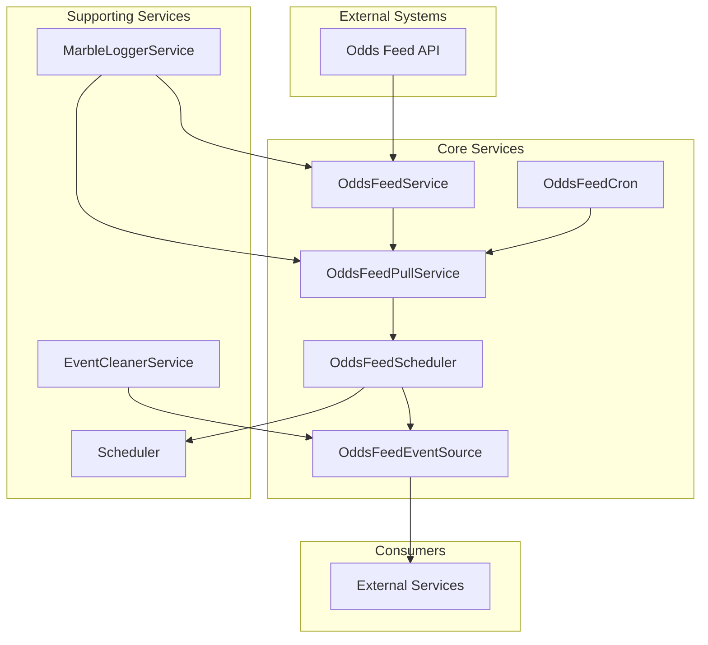
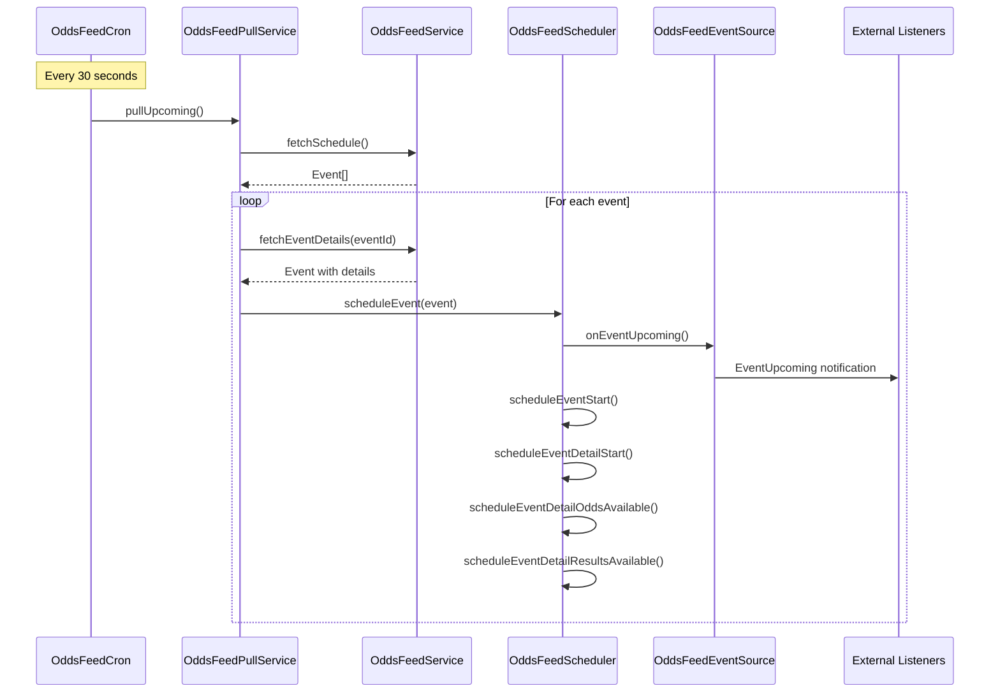
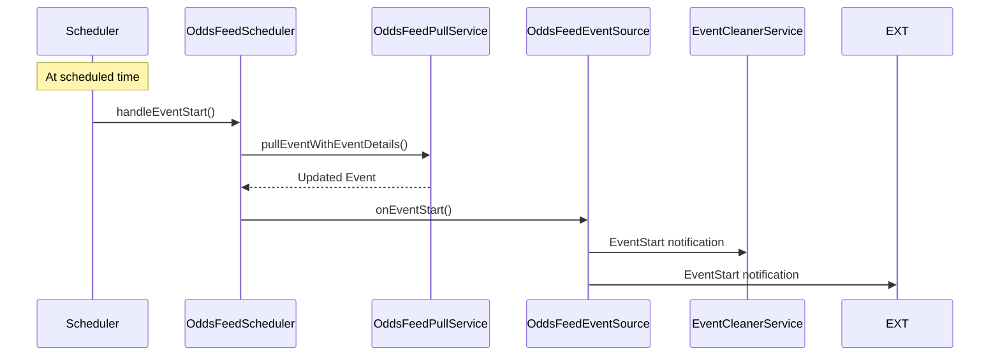

# Odds Feed Client

The **odds-feed-client** is a TypeScript library that acts as a bridge between external odds feed APIs and Marble game services. It periodically fetches event data, schedules event processing, and emits domain events for consumption by other services.

## Installation

```bash
npm install odds-feed-client
# or
yarn add odds-feed-client
# or
pnpm add odds-feed-client
```

If you use the Awilix adapter shown below, also install `awilix` (it is already a dependency here, so this is optional for most setups):

```bash
npm install awilix
```

If you don't use Awilix, you must inherit interface DiContainer

```ts
import { DiContainer } from "odds-feed-client/container";
```

## Quick start (TypeScript)

Overview of this is:

- Write event event handling code for you own service.
- Create container and bind dependencies (currently Awilix is the most optimal)
- Register event from the oddsFeedEventSource
- Call diContainer.init to start listening data from the event source

You could refer to the example code in this repo at the /example folder

### Prepare your appConfigs

The app config requires both Odds Feed and Sentry Credential to be able to function normally.

```ts
const appConfigs = {
   oddsFeedAPI: {
        url: "<your-odds-feed-api-url>";
        operatorId: "<your-operator-id>";
        password: "<your-operator-password>";
    };
    sentry: {
        sentryUrl: "<your-sentry-dsn>";
        logIdentifier: "<your-sentry-log-identifier>";
        env: "<your-sentry-env>";
    };
}

```

### Develop your own services to get data from the odds feed event source.

Develop your own service to meet the business requirement. For example, this is a log service.

And this is also a recommended pattern.

```ts
import {
  OddsFeedEventSource,
  OddsFeedEventName,
  EventListener,
  EventNotification,
  EventDetailNotification,
  EventDetailListener,
} from "odds-feed-client";

interface LogServiceContainer {
  oddsFeedEventSource: OddsFeedEventSource;
}

export class LogService {
  private readonly oddsFeedEventSource: OddsFeedEventSource;

  private readonly boundHandleEventUpcoming: EventListener;
  private readonly boundHandleEventDetailUpComing: EventDetailListener;

  constructor(container: LogServiceContainer) {
    this.oddsFeedEventSource = container.oddsFeedEventSource;
    this.boundHandleEventUpcoming = this.handleEventUpcoming.bind(this);
    this.boundHandleEventDetailUpComing = this.handleEventDetailUpComing.bind(this);
  }

  init() {
    this.oddsFeedEventSource.eventOn(OddsFeedEventName.EventUpcoming, this.boundHandleEventUpcoming);
    this.oddsFeedEventSource.eventDetailOn(OddsFeedEventName.EventDetailUpComing, this.boundHandleEventDetailUpComing);
  }

  dispose() {
    this.oddsFeedEventSource.eventOff(OddsFeedEventName.EventUpcoming, this.boundHandleEventUpcoming);
    this.oddsFeedEventSource.eventDetailOff(OddsFeedEventName.EventDetailUpComing, this.boundHandleEventDetailUpComing);
  }

  handleEventUpcoming({ event }: EventNotification) {
    console.log(new Date().toISOString());
    console.log("Event Upcoming", event.scheduleStartTs);
  }

  handleEventDetailUpComing({ event, index }: EventDetailNotification) {
    console.log(new Date().toISOString());
    console.log("Event Detail Up Coming", event.scheduleStartTs, index);
  }
}
```

### Create dependencies helper

Create a dependencies helper functions for registering and init wanted service.

These functions should be in folder container-registry.ts (optional and conventional).

Best practice: If the project is multi-team maintained, each team handle one container-registry.ts and a set of services that is used in that file, this will reduce Git model complexity since each team manage their own files.

```ts
import { DiContainer } from "odds-feed-client/container";
import { appConfigs } from "./app-configs";
import { LogService } from "./log-service";
import { CustomLogger } from "./logger";

export function registerLogServices(diContainer: DiContainer) {
  diContainer.register({
    registerType: "class",
    key: "logService",
    value: LogService,
  });

  diContainer.register({
    registerType: "class",
    key: "logger",
    value: CustomLogger,
  });

  diContainer.register({
    registerType: "value",
    key: "appConfigs",
    value: appConfigs,
  });
}

export function initLogServices(diContainer: DiContainer) {
  diContainer.resolve<LogService>("logService").init();
}
```

### Create a container and register dependencies and init dependencies

Create a container with Awilix, and wrap it with container adapter.
Then register and init dependencies by calling these functions from container registry file and the odds feed client container registration functions.

```ts
import { createContainer } from "awilix";
import { init, register } from "odds-feed-client/dependency-injection";
import { AwilixDIContainer } from "odds-feed-client/awilix";

import { registerLogServices, initLogServices } from "./container-registry";

const container = createContainer();

const diContainer = new AwilixDIContainer(container);

register(diContainer);
registerLogServices(diContainer);
init(diContainer);
initLogServices(diContainer);
```

### Configs:

#### Odds Feed Filter

- You can filter what event to be processed by injecting odds feed filter to the container.

```ts
import { register } from "odds-feed-client/dependency-injection";
import { createContainer } from "awilix";
import { AwilixDIContainer } from "odds-feed-client/awilix";

const container = createContainer();
const diContainer = new AwilixDIContainer(container);

register<MarbleEvent>(diContainer, {
  oddsFeedFilter,
});
```

#### Event Queue Max Length

This specify how many events lives in the memory. On max event exceeded, the cleanup event will be emitted to let you know that event should be deleted. You have handle that event and implement the cleanup logic yourself in case you persist event on your own service memory.

```ts
import { createContainer } from "awilix";
import { init, register } from "odds-feed-client/dependency-injection";
import { AwilixDIContainer } from "odds-feed-client/awilix";

const container = createContainer();

const diContainer = new AwilixDIContainer(container);

register(diContainer, {
  eventQueueMaxLength: 2,
});
```

## Architecture Map



The "External Services" is where your own services consumes the events.

## Features & Services

### Core Services

| Service                 | Purpose                  | Key Methods                                                 | Dependencies                                           |
| ----------------------- | ------------------------ | ----------------------------------------------------------- | ------------------------------------------------------ |
| **OddsFeedService**     | API client for odds feed | `fetchSchedule()`, `fetchEventDetails()`, `getRemoteJson()` | AppConfigs, Logger, MarbleLoggerService                |
| **OddsFeedPullService** | Data orchestration       | `pullUpcoming()`, `pullEventWithEventDetails()`             | OddsFeedService, OddsFeedStore, Logger, oddsFeedFilter |
| **OddsFeedCron**        | Periodic scheduling      | `start()`, `scheduleNextEventsCron()`                       | OddsFeedPullService, OddsFeedScheduler, Logger         |
| **OddsFeedScheduler**   | Event timing             | `scheduleEvent()`, `scheduleEventUpcoming()`                | OddsFeedEventSource, Scheduler, OddsFeedPullService    |
| **OddsFeedEventSource** | Event emission           | `emitEventStart()`, `emitEventUpcoming()`, `eventOn()`      | None (EventEmitter)                                    |

### Supporting Services

| Service                 | Purpose                   | Key Methods                                | Dependencies        |
| ----------------------- | ------------------------- | ------------------------------------------ | ------------------- |
| **EventCleanerService** | Memory management         | `handleEventStart()`, `dispose()`          | OddsFeedEventSource |
| **MarbleLoggerService** | Logging & monitoring      | `log()`, `error()`, `warning()`, `debug()` | AppConfigs          |
| **Scheduler**           | Time-based task execution | `schedule()`, `cancel()`, `dispose()`      | None                |

## Cron Flow

### Main Execution Flow



### Event Lifecycle



## Component Guide

### Domain Models

#### Event (`src/domain/index.ts`)

```typescript
type Event = {
  eventID: number;
  eventNameAKey: string;
  eventNameBKey: string;
  theme?: string;
  scheduleStartTs: string;
  productCode: string;
  productTypeKey: string;
  eventDetails: EventDetail[];
  voiceConfig?: string;
};
```

#### EventDetail (`src/domain/index.ts`)

```typescript
type EventDetail = {
  eventID: number;
  oddsAvailableTs: string;
  scheduleStartTs: string;
  resultsAvailableTs: string;
  hasResults: boolean;
  goalInfo: string;
  playlist: string;
  result: string;
  markets: any;
  inGameEventInfo: string;
  phase: number;
};
```

#### AppConfigs (`src/interfaces/app-config.ts`)

```typescript
interface AppConfigs {
  oddsFeedAPI: {
    url: string;
    operatorId: string;
    password: string;
  };
  sentry?: {
    sentryUrl: string;
    logIdentifier: string;
    env: string;
    debug?: boolean;
  };
}
```

#### Logger (`src/interfaces/logger.ts`)

```typescript
interface Logger {
  logError: (message: string) => void;
}
```

#### Event Types (`src/interfaces/odds-feed-event-source.ts`)

```typescript
export enum OddsFeedEventName {
  Wildcard = "*",
  EventStart = "event.ScheduleStart",
  EventDetailUpComing = "eventDetail.UpComing",
  EventDetailStart = "eventDetail.ScheduleStart",
  EventDetailOddsAvailable = "eventDetail.OddsAvailable",
  EventDetailResultsAvailable = "eventDetail.ResultsAvailable",
  EventUpcoming = "event.Upcoming",
}

export enum SystemEventName {
  DataCleanup = "system.DataCleanup",
}

export interface EventDetailNotification<TEvent extends Event = Event> {
  event: TEvent;
  index: number;
}

export interface EventNotification<TEvent extends Event = Event> {
  event: TEvent;
}

export interface SystemNotification {
  eventID: number;
}
```

### Service Details

#### OddsFeedService (`src/services/odds-feed-service.ts`)

- **Authentication**: Handles OAuth token management
- **API Calls**: Makes HTTP requests to odds feed endpoints
- **Retry Logic**: Built-in retry mechanism with exponential backoff
- **Error Handling**: Comprehensive error logging via MarbleLoggerService

#### OddsFeedPullService (`src/services/odds-feed-pull-service.ts`)

- **Data Orchestration**: Coordinates between API calls and storage
- **Filtering**: Applies user-defined filters to events
- **Storage**: Manages event storage in OddsFeedStore
- **Game ID Extraction**: Uses idHelper to extract gameId from eventId

#### OddsFeedScheduler (`src/services/odds-feed-scheduler.ts`)

- **Event Scheduling**: Schedules multiple event types per event
- **Time Management**: Handles different timestamps (start, odds, results)
- **Event Emission**: Triggers appropriate events at scheduled times
- **Retry Logic**: Built-in retry for result availability

#### EventCleanerService (`src/services/event-cleaner-service.ts`)

- **Memory Management**: Prevents memory leaks by cleaning old events
- **Queue Management**: Maintains FIFO queue per game (max 50 events)
- **Automatic Cleanup**: Triggers cleanup when queue exceeds limit
- **Event Emission**: Emits system cleanup events

#### MarbleLoggerService (`src/services/marble-logger-service.ts`)

- **Sentry Integration**: Built-in Sentry error tracking and monitoring
- **Structured Logging**: Consistent log format with annotations
- **Environment Support**: Debug mode for development
- **Tag Management**: Automatic gameId and eventId tagging

#### Scheduler (`src/services/scheduler.ts`)

- **Time-based Execution**: Schedules callbacks for future execution
- **Task Management**: Prevents duplicate scheduling with key-based deduplication
- **Memory Management**: Automatic cleanup of completed tasks
- **Error Handling**: Safe callback execution with try-catch

### Dependency Injection

#### Registration (`src/dependency-injection/index.ts`)

```typescript
// Core services registered as singletons
marbleLoggerService -> MarbleLoggerServiceImpl
oddsFeedEventSource -> OddsFeedEventSourceImpl
oddsFeedPullService -> OddsFeedPullServiceImpl
oddsFeedScheduler -> OddsFeedSchedulerImpl
eventCleanerService -> EventCleanerServiceImpl (with disposer)
scheduler -> SchedulerImpl (with disposer)
oddsFeedService -> OddsFeedServiceImpl
oddsFeedCron -> OddsFeedCronImpl
oddsFeedFilter -> Function (configurable)
```

#### Initialization Flow

1. **MarbleLoggerService.init()** - Initialize logging
2. **EventCleanerService.initEvent()** - Register event listeners
3. **OddsFeedCron.start()** - Start periodic scheduling

## Improvements & Refactors

### High Priority Issues

#### 1. **Console.log Usage** ⚠️ **PARTIALLY FIXED**

- **Issue**: Direct console.log usage instead of proper logging
- **Impact**: Inconsistent logging, no log level control
- **Status**: ⚠️ **PARTIALLY FIXED** - Some console.log usage still remains in `src/services/odds-feed-store.ts:56`
- **Files**: `src/services/odds-feed-scheduler.ts`, `src/services/odds-feed-store.ts`

**Example Fix:**

```typescript
// ❌ Before (src/services/odds-feed-scheduler.ts:118)
console.error(`Failed to get event details for event ${event.eventID} and index ${index} after ${retry} retries`);

// ✅ After
this.logService.error(
  `Failed to get event details for event ${event.eventID} and index ${index} after ${retry} retries`
);

// ❌ Before (src/services/odds-feed-store.ts:56)
console.log(`Cleaning up event ${eventId} for game ${gameId}`);

// ✅ After
this.marbleLoggerService.log(`Cleaning up event ${eventId} for game ${gameId}`, { eventId });
```

### Medium Priority Improvements

#### 6. **Async/Await Patterns**

- **Issue**: Mixed Promise handling patterns
- **Impact**: Potential race conditions and error handling issues
- **Fix**: Standardize on async/await with proper error boundaries
- **Files**: `src/services/odds-feed-cron.ts:45-51`

**Example Fix:**

### Naming & API Design Issues

## Requirements

- Node.js >= 18
